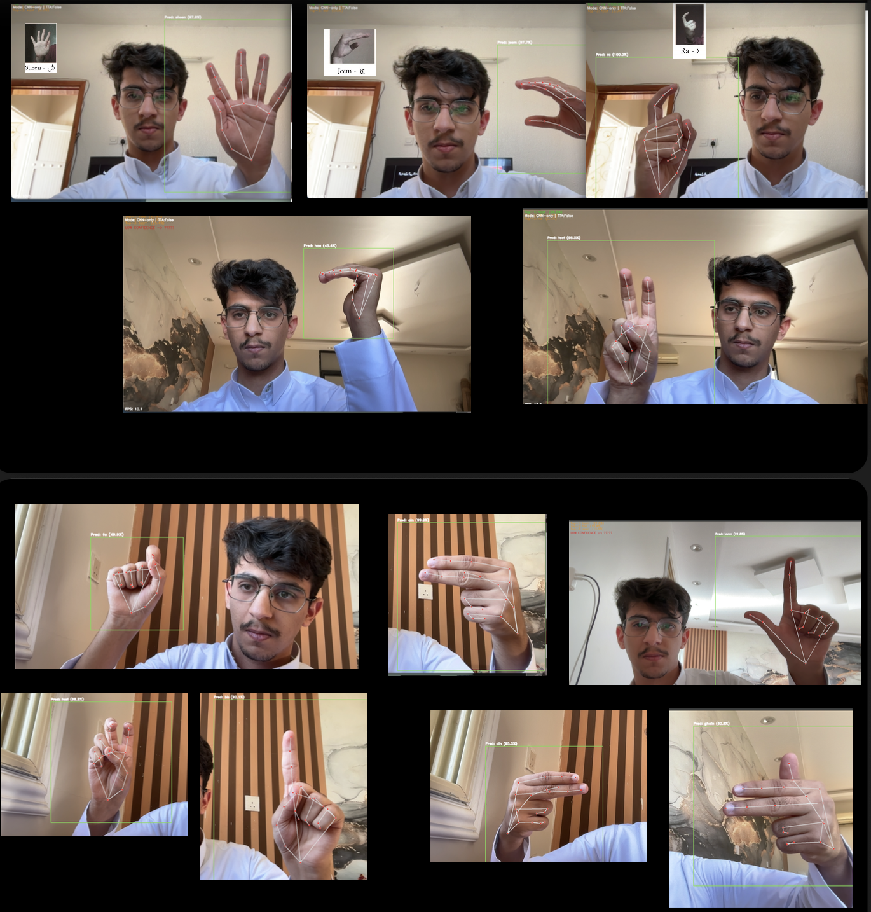

# Real-Time Arabic Sign Language Recognition

Recognizes the 32 letters of the Arabic sign language alphabet from a webcam feed, as a building block for accessibility tools for deaf and hard-of-hearing users. Includes an offline hybrid model that fuses CNN image features with hand-geometry features.


<p align="center">
  
</p>
<p align="center"><sub>Frames from the live webcam app (<code>src/live_asl_cam.py</code>, CNN-only mode). Low-confidence predictions are flagged on screen.</sub></p>

## Overview

Fingerspelling is how signers spell names and words that have no dedicated sign, so a letter recognizer is a basic building block for Arabic sign language tools. Several letters differ only in finger angle or orientation, and a webcam frame adds background clutter, lighting changes, and a moving hand. This project trains three models on a balanced 96,000-image subset of the public [ASLAD-190K dataset](https://www.kaggle.com/datasets/boulesnane/aslad-190k-arabic-sign-language-alphabet-dataset) (3,000 images for each of the 32 classes): an InceptionV3 transfer-learning image classifier, a landmarks-only MLP, and a hybrid that feeds CNN embeddings plus hand-geometry features into XGBoost. A separate script runs the InceptionV3 model live on a webcam with MediaPipe hand cropping and temporal smoothing.

## Evaluation note

The notebook reports test-set accuracy for every model, and this README intentionally does not repeat those figures. The 80/10/10 split was made at random over individual images. As a result, most test images have a near-identical, same-class image in the training set, and some are exact copies. On that split, test accuracy mostly measures how well a model recognizes frames it has nearly seen, not how well it generalizes to a new person, hand, or room. The same applies to the ROC-AUC values in the notebook.

The fix is a grouped split: hold out whole signers (or whole capture sessions) so that no person or video contributes to both training and test, and deduplicate near-identical frames before splitting. Numbers will be reported here once the models are re-evaluated that way.

## How it works

**Offline training** (`src/model.ipynb`):

1. **Data split.** The balanced 96,000-image subset is split 80/10/10 into 76,800 / 9,600 / 9,600 images with `split-folders`.
2. **Landmarks-only MLP.** The dataset ships an 89-value hand-geometry vector per image (63 coordinates for 21 hand landmarks, plus 26 joint angles). A small Keras MLP is trained on these standardized features alone, using its own stratified 80/10/10 split of the CSV.
3. **InceptionV3 classifier.** An ImageNet-pretrained InceptionV3 (299x299 input) with a new head (global average pooling, 512-unit dense layer, dropout, 32-way softmax) and on-the-fly augmentation (flip, rotation, translation, zoom, contrast, brightness, noise, crop).
   - Stage 1: backbone frozen, head trained at learning rate 1e-3.
   - Stage 2: intended to unfreeze the last 40 backbone layers at learning rate 1e-6 (see Limitations: in the saved model the backbone is still frozen).
4. **Hybrid model.** The 2,048-dimensional pooled embedding from the stage-2 CNN is concatenated with the standardized 89-value geometry vector, giving 2,137 features per image. An XGBoost classifier (`multi:softprob`, 800 trees, max depth 7, learning rate 0.05) is trained on the combined features.

**Live app** (`src/live_asl_cam.py`):

1. MediaPipe Hands finds one hand in each webcam frame and gives its landmarks.
2. The script crops a square region around the hand with a 30% margin and resizes it to 299x299.
3. The stage-2 InceptionV3 model predicts a probability for each of the 32 letters.
4. Predictions are smoothed with an exponential moving average (alpha 0.2) and an 8-frame majority vote. If the top class is below 0.7 confidence, the app adds a low-confidence warning next to the prediction.
5. The frame shows the hand skeleton, the crop box, the top-3 letters, and the FPS.

## Repository layout

```text
.
├── src/
│   ├── model.ipynb          # data split, all three models, evaluation
│   └── live_asl_cam.py      # real-time webcam recognizer (CNN-only)
├── models/
│   ├── model.InceptionV3_stage1.keras   # Git LFS
│   ├── model.InceptionV3_stage2.keras   # Git LFS, used by the live app
│   ├── asl_landmarks.weights.h5         # Git LFS, landmarks-only MLP weights
│   └── xgb_cnn_plus_landmarks.json      # hybrid XGBoost model
├── docs/images/
│   ├── demo.png             # frames from the live app
│   └── arabicletters.jpeg   # reference chart of the 32 letter signs
├── requirements.txt
└── .python-version          # 3.11.7
```

The dataset itself is not in the repository. A [reference chart of the 32 signs](docs/images/arabicletters.jpeg) is included.

## Run it

The pinned requirements target Apple Silicon (`tensorflow-macos` and `tensorflow-metal`). On other platforms, replace those two lines with the standard `tensorflow==2.15.0` package.

```bash
git lfs install
git clone https://github.com/RayanAlDwlah/Real-Time-Arabic-Sign-Language-Recognition.git
cd Real-Time-Arabic-Sign-Language-Recognition
git lfs pull

python -m venv .venv && source .venv/bin/activate
pip install -r requirements.txt
```

**Live webcam demo.** The script loads `model.InceptionV3_stage2.keras` from the current directory, so run it from inside `models/`:

```bash
cd models
python ../src/live_asl_cam.py
```

Keys: `m` toggles the mirror view, `s` toggles flip test-time augmentation, `r` resets smoothing, `q` quits.

**Training notebook.** Download ASLAD-190K from Kaggle into `data/` so the paths in `src/model.ipynb` (`data/ASLAD-190K/ASLAD-96K/...`) resolve. The split cell is commented out; uncomment it to rebuild `data_splitted/`.

## Limitations and next steps

- **Evaluation leaks.** See the Evaluation note. The next step is a signer- or session-grouped split with near-duplicate removal, then reporting macro-F1 and per-class recall on that split.
- **The live app is CNN-only.** The hybrid XGBoost model is evaluated offline but is not wired into the webcam app, and its landmark scaler and class list (`features_hybrid/`) are not in the repository, so it cannot be rerun from the repo alone.
- **Stage 2 did not unfreeze the backbone.** The notebook reloads the stage-1 model from disk, then sets `trainable` on layers of the earlier in-memory `base_model` object. The model summary after that step still reports 1,065,504 trainable parameters, and the saved stage-2 model has every InceptionV3 layer frozen. Stage 2 is in effect continued head training at a lower learning rate. The fix is to unfreeze layers on the reloaded model's own `inception_v3` sub-model.
- **Geometry features are from the dataset.** The 89-value vectors used in training come from the dataset's CSV. The live app computes MediaPipe landmarks but only uses them to crop the hand, so a hybrid live mode would also need to reproduce the dataset's 26 angle features.
- **Letters only.** No words, sentences, or motion-based signs. Real-time speed and accuracy on new users have not been measured.

---

Built by Rayan Saleh Al-Dwlah · [LinkedIn](https://www.linkedin.com/in/rayanaldwlah)
